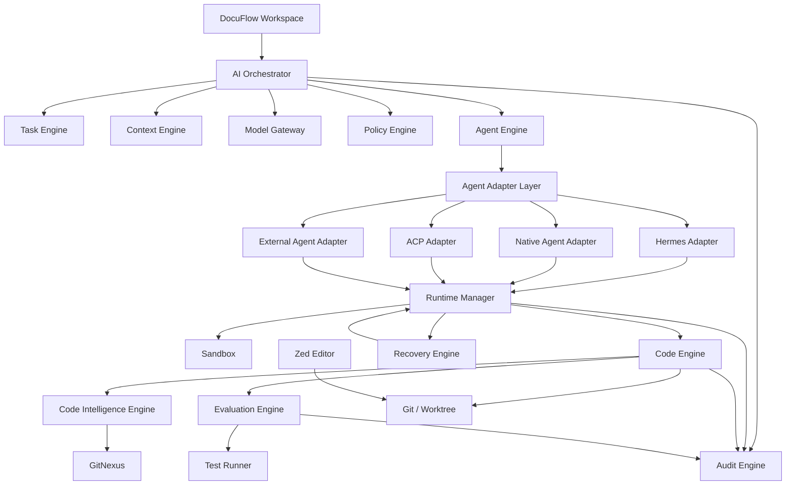
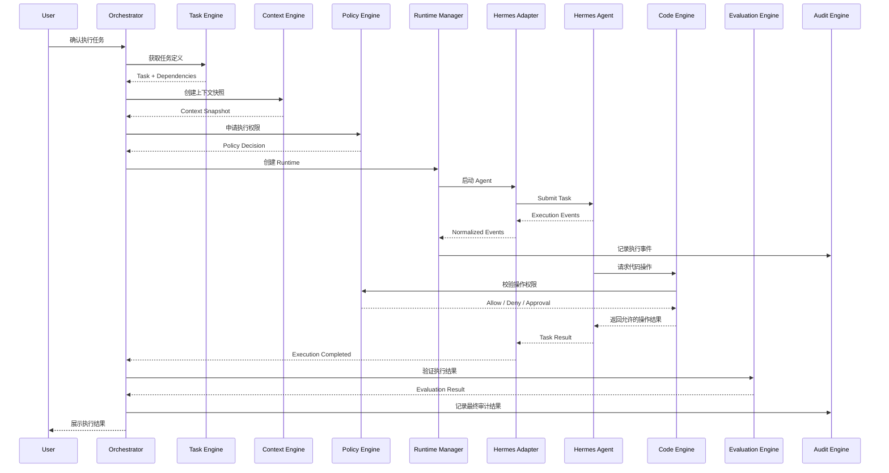
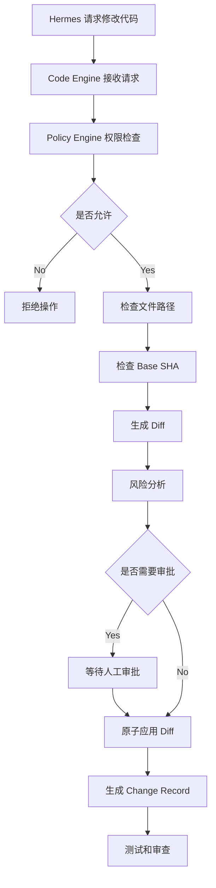
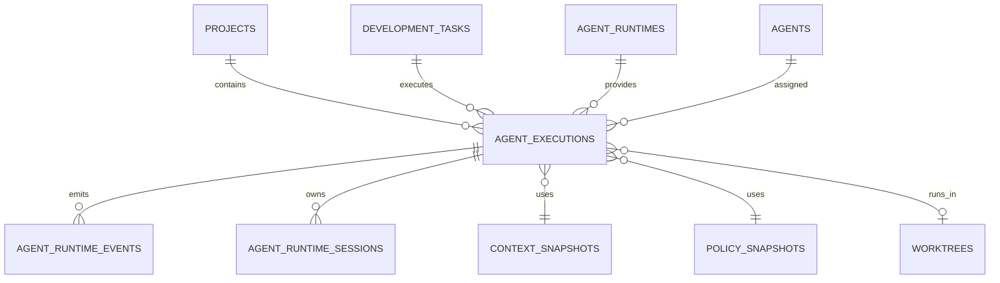
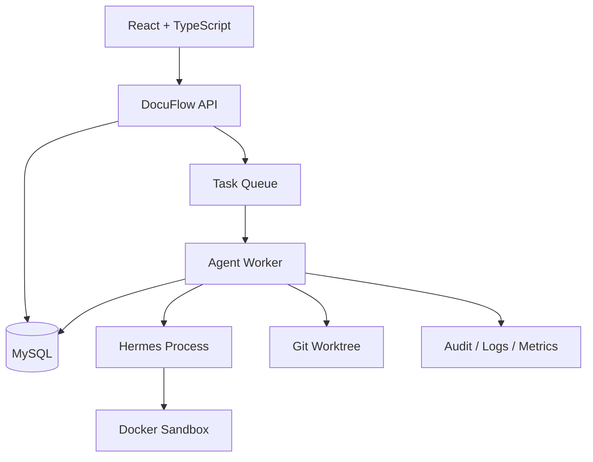

# DocuFlow AI Agent Runtime 与 Hermes Agent 集成设计 V1.0

- 产品：DocuFlow AI
- 文档类型：技术架构与集成设计
- 版本：V1.0
- 架构基线：DocuFlow AI V1.2
- 状态：设计稿，待架构冻结
- 集成对象：NousResearch/Hermes Agent

---

# 1. 设计目标

## 1.1 背景

DocuFlow AI 是一个文档驱动的 AI 软件开发平台。

平台通过需求文档、架构文档、功能拆分、任务规划和验收标准控制软件开发过程。

现有架构已经包含：

- AI Orchestrator
- Agent Engine
- Context Engine
- Model Gateway
- Code Intelligence Engine
- Code Engine
- Policy & Permission Engine
- Runtime Manager
- Evaluation Engine
- Recovery Engine
- Audit Engine

引入 Hermes Agent 的目的不是重新实现一套 Agent 平台，而是利用成熟的 Agent 执行框架，补充 DocuFlow 的实际任务执行能力。

## 1.2 核心目标

1. 接入 Hermes Agent，提供可复用的外部 Agent Runtime。
2. 保留 DocuFlow 对任务、权限、上下文和执行生命周期的控制权。
3. 支持 Hermes、DocuFlow Native Agent、ACP Agent 等多种执行后端。
4. 将 Hermes 的工具调用、执行过程、输出和异常转换为统一事件。
5. 所有代码变更必须经过 DocuFlow Code Engine。
6. 所有敏感操作必须经过 Policy Engine。
7. 所有执行过程必须能够审计、恢复和追溯。
8. Hermes 可以独立升级或替换，不影响 DocuFlow 核心业务。

## 1.3 非目标

V1 不做以下工作：

- 不 Fork Hermes 并修改其核心代码。
- 不将 Hermes 作为 DocuFlow 的主调度器。
- 不直接采用 Hermes 自己的任务状态作为 DocuFlow 任务状态。
- 不允许 Hermes 直接操作 DocuFlow 数据库。
- 不允许 Hermes 绕过 Code Engine 修改正式项目工作区。
- 不让 Hermes Memory 成为项目正式需求或技术决策的唯一来源。
- 不将 Hermes 自带的工具权限直接视为 DocuFlow 的权限体系。
- 不将 Hermes 的所有工具和插件无条件开放给 Agent。

---

# 2. 核心架构原则

## 2.1 职责划分

| 系统 | 核心职责 |
|---|---|
| DocuFlow Orchestrator | 决定执行什么任务 |
| Agent Engine | 选择 Agent 和执行后端 |
| Hermes Agent | 执行被分配的任务 |
| Context Engine | 提供经过版本确认的任务上下文 |
| Policy Engine | 决定 Agent 可以做什么 |
| Runtime Manager | 管理执行环境和生命周期 |
| Code Engine | 控制代码读取、Diff 和写入 |
| Evaluation Engine | 判断执行结果是否合格 |
| Audit Engine | 记录执行过程和变更证据 |
| Recovery Engine | 处理失败、中断和恢复 |

核心原则：

**DocuFlow 管理开发过程，Hermes 执行具体任务。**

## 2.2 单一控制平面

DocuFlow 是唯一的任务控制平面。

Hermes 是可替换的执行平面。

Hermes 可以在内部完成：

- Agent Loop
- 模型调用
- 工具选择
- 工具执行
- Skills 加载
- Subagent 委派
- 执行结果整理

但是不能自行决定：

- 是否允许执行某个 DocuFlow 任务
- 是否允许修改某个项目文件
- 是否允许安装依赖
- 是否允许修改数据库结构
- 是否允许合并分支
- 是否允许发布项目
- 是否可以跳过验收

这些决策必须由 DocuFlow 完成。

---

# 3. 总体架构



## 3.1 Agent Adapter Layer

新增独立模块：

Agent Adapter Layer。

负责屏蔽不同 Agent 框架之间的协议差异。

统一能力：

- Agent 注册
- Agent 能力发现
- 创建执行实例
- 提交任务
- 获取执行事件
- 取消任务
- 获取执行结果
- 获取工具调用记录
- 获取运行状态
- 错误转换
- 运行环境绑定

未来接入其他 Agent 时，不需要修改 Orchestrator。

---

# 4. Hermes 接入协议

## 4.1 Hermes 提供的接入方式

| 协议 | 通信方式 | 主要场景 | DocuFlow 定位 |
|---|---|---|---|
| HTTP API | HTTP + SSE | Web 应用和服务端 | P0 快速验证 |
| TUI Gateway | JSON-RPC + WebSocket/stdio | 自定义宿主、会话和审批控制 | P1 深度集成候选 |
| ACP | JSON-RPC over stdio | Zed、VS Code 等编辑器 | 编辑器集成 |

## 4.2 P0 接入方案

第一阶段使用 Hermes HTTP API 验证：

- Agent 调用
- Session 管理
- 流式输出
- 工具执行进度
- 任务取消
- 失败状态识别

HTTP API 采用 OpenAI 兼容接口，适合快速构建第一个 Hermes Adapter。

但需要注意：

OpenAI 兼容不等于所有执行能力都具有相同的控制语义。

DocuFlow 必须验证实际支持的 Session、Run、Cancel、SSE 事件及错误状态。

## 4.3 P1 深度集成

进一步评估 TUI Gateway JSON-RPC。

重点验证：

- 会话生命周期
- 实时事件订阅
- 工具调用状态
- 审批交互
- 取消与中断
- 断线重连
- 会话恢复

如果 TUI Gateway 能够满足 DocuFlow 所需的生命周期和审批控制，再将其作为主要的 Hermes 深度集成协议。

不应将 Hermes 内部未承诺稳定的实现细节暴露给 DocuFlow 业务层。

## 4.4 ACP 的使用边界

ACP 主要用于编辑器与 Agent 之间的通信。

DocuFlow 可以使用 ACP 连接 Hermes 与 Zed，但不能因此将 ACP 当作整个 DocuFlow 的任务调度协议。

建议：

- Zed ↔ ACP ↔ Hermes：编辑器交互。
- DocuFlow ↔ Hermes Adapter ↔ Hermes：平台任务执行。
- DocuFlow ↔ Code Engine：代码变更控制。

三条链路职责分离。

---

# 5. Agent Adapter 接口设计

## 5.1 统一接口

```typescript
export type AgentRuntimeType =
  | "hermes"
  | "native"
  | "acp"
  | "external";

export type AgentExecutionStatus =
  | "queued"
  | "starting"
  | "running"
  | "waiting_approval"
  | "cancelling"
  | "succeeded"
  | "failed"
  | "cancelled"
  | "interrupted";

export interface AgentCapability {
  streaming: boolean;
  cancellation: boolean;
  sessionResume: boolean;
  toolEvents: boolean;
  permissionEvents: boolean;
  subAgents: boolean;
  skills: boolean;
}

export interface AgentTaskInput {
  projectId: string;
  featureId?: string;
  taskId: string;
  runId: string;

  prompt: string;

  contextSnapshotId: string;
  policySnapshotId: string;

  worktreeId: string;
  workingDirectory: string;

  allowedTools: string[];
  timeoutSeconds: number;

  correlationId: string;
}

export interface AgentExecution {
  executionId: string;
  runtimeType: AgentRuntimeType;
  status: AgentExecutionStatus;
  externalSessionId?: string;
  externalRunId?: string;
}

export interface AgentRuntimeAdapter {
  getCapabilities(): Promise<AgentCapability>;

  healthCheck(): Promise<boolean>;

  start(input: AgentTaskInput): Promise<AgentExecution>;

  getStatus(executionId: string): Promise<AgentExecutionStatus>;

  cancel(executionId: string): Promise<void>;

  resume(executionId: string): Promise<AgentExecution>;

  subscribe(
    executionId: string,
    handler: (event: AgentRuntimeEvent) => void
  ): Promise<() => Promise<void>>;

  terminate(executionId: string): Promise<void>;
}
```

接口是 DocuFlow 自己的稳定契约。

Hermes Adapter 负责把它转换为 Hermes 当前实际支持的协议。

注意：resume 能力必须由 Adapter 声明。若当前 Hermes 接入协议不支持可靠续跑，应返回不支持，由 Recovery Engine 创建新的执行实例并注入 Checkpoint。

## 5.2 统一事件模型

```typescript
export type AgentRuntimeEventType =
  | "execution.started"
  | "message.delta"
  | "message.completed"
  | "tool.started"
  | "tool.progress"
  | "tool.completed"
  | "tool.failed"
  | "permission.requested"
  | "execution.waiting"
  | "execution.completed"
  | "execution.failed"
  | "execution.cancelled";

export interface AgentRuntimeEvent {
  eventId: string;
  executionId: string;
  projectId: string;
  taskId: string;

  sequence: number;
  eventType: AgentRuntimeEventType;

  timestamp: string;

  payload: Record<string, unknown>;

  externalEventId?: string;
}
```

要求：

1. 事件必须关联 DocuFlow Execution ID。
2. 事件必须支持重复投递去重。
3. 事件必须包含时间戳和序列号。
4. 事件必须支持审计持久化。
5. 事件顺序不能完全依赖客户端收到消息的顺序。
6. 未识别的 Hermes 事件应保留原始信息，不得直接丢弃。

---

# 6. 任务执行生命周期

## 6.1 完整执行流程



## 6.2 执行阶段

| 阶段 | 负责模块 | 说明 |
|---|---|---|
| 任务准备 | Task Engine | 检查任务状态和依赖 |
| 上下文准备 | Context Engine | 生成任务上下文快照 |
| 权限检查 | Policy Engine | 生成权限决策 |
| 环境准备 | Runtime Manager | 分配 Worktree 和 Sandbox |
| Agent 启动 | Hermes Adapter | 创建 Hermes 执行会话 |
| 任务执行 | Hermes | 处理任务和工具调用 |
| 变更控制 | Code Engine | 校验和应用变更 |
| 结果验证 | Evaluation Engine | 执行测试与独立审查 |
| 记录追溯 | Audit Engine | 保存事件和证据 |
| 故障处理 | Recovery Engine | 中断、恢复和重试 |

---

# 7. Code Engine 集成与文件权限控制

这是整个 Hermes 集成中最重要的安全边界。

## 7.1 基本原则

Hermes 可以理解代码、分析代码和提出修改方案。

但是 Hermes 不能拥有项目正式工作区的无限写权限。

所有正式代码变更必须经过 Code Engine。

## 7.2 推荐执行方式

V1 采用两种模式：

### 模式 A：受控工具调用

Hermes 通过 DocuFlow 提供的工具访问代码：

- read_file
- search_code
- get_project_tree
- analyze_code
- request_diff
- request_apply_diff

写入类工具必须经过 Code Engine 和 Policy Engine。

### 模式 B：隔离 Worktree

如果 Hermes 需要使用自己的终端和文件工具：

- 每个执行实例使用独立 Worktree。
- Worktree 绑定明确的 Git Base SHA。
- Sandbox 限制文件系统、网络和系统调用。
- Hermes 不得访问其他项目 Worktree。
- 完成后 Code Engine 重新检查 Git Diff。
- 检查通过后才允许进入提交和测试阶段。

V1 推荐优先实现模式 A。

模式 B 作为后续能力，在隔离边界和文件权限验证通过后开放。

## 7.3 文件变更流程



## 7.4 禁止事项

Hermes 不允许：

- 修改 DocuFlow 数据库。
- 直接修改 Git 历史。
- 执行 git reset --hard。
- 删除其他 Agent 的 Worktree。
- 访问宿主机敏感目录。
- 读取不属于当前项目的环境变量。
- 未经批准安装依赖。
- 未经批准执行数据库 Migration。
- 未经批准进行 Git Merge。
- 未经批准发布生产环境。

---

# 8. Policy Engine 权限映射

## 8.1 权限等级

| 等级 | 操作 | 默认策略 |
|---|---|---|
| P0 | 读取项目文件 | 允许 |
| P0 | 搜索代码 | 允许 |
| P0 | 查询 GitNexus | 允许 |
| P1 | 生成 Diff | 允许 |
| P1 | 修改任务工作区 | 按范围授权 |
| P2 | 删除文件 | 人工审批 |
| P2 | 安装依赖 | 人工审批或策略授权 |
| P2 | 修改公共 API | 人工审批 |
| P2 | 修改数据库结构 | 人工审批 |
| P3 | Git Merge | 人工审批 |
| P3 | 发布生产环境 | 人工审批 |
| P3 | 访问生产数据 | 默认禁止 |

## 8.2 权限执行机制

权限判断不能只通过 Prompt。

必须采用代码层强制执行：

1. Orchestrator 创建任务。
2. Policy Engine 生成策略快照。
3. Runtime Manager 创建受限环境。
4. Hermes 获得受限工具集合。
5. 每次敏感操作重新检查策略。
6. 超出授权范围立即拒绝。
7. 拒绝事件写入 Audit Engine。

权限快照应关联：

- project_id
- task_id
- execution_id
- worktree_id
- policy_version
- granted_capabilities
- expires_at

---

# 9. Context Engine 集成

## 9.1 上下文来源

DocuFlow 提供正式任务上下文：

| 层级 | 内容 |
|---|---|
| L1 项目上下文 | 项目目标、技术栈、项目约束 |
| L2 功能上下文 | 功能需求、设计和验收标准 |
| L3 任务上下文 | 当前任务、依赖和完成条件 |
| L4 执行上下文 | 当前代码、Diff、Git SHA、测试结果 |
| L5 知识上下文 | GitNexus、历史决策、项目知识 |

## 9.2 Hermes Memory 的定位

Hermes 自带 Memory 主要负责 Agent 自身的长期记忆和会话连续性。

DocuFlow Context Engine 负责项目级正式事实。

两者不应混为一谈。

规则：

- 正式需求以已确认的需求文档为准。
- 技术决策以已批准的架构记录为准。
- 当前代码状态以 Git SHA 为准。
- 任务完成状态以 Evaluation 结果为准。
- Hermes Memory 只能作为辅助知识来源。
- Hermes 记忆与正式项目文档冲突时，以 DocuFlow 已确认版本为准。

## 9.3 上下文快照

每次 Agent Run 都必须生成 Context Snapshot。

至少保存：

- snapshot_id
- project_id
- task_id
- document_versions
- architecture_version
- git_base_sha
- gitnexus_index_version
- selected_files
- context_hash
- created_at

这样可以在事后回答：

某次 Agent 修改代码时，实际读取的是哪个版本的需求和技术设计？

---

# 10. Skills 集成设计

## 10.1 Skill 分类

建议将 Skills 分为三类：

| 类型 | 管理方 | 示例 |
|---|---|---|
| Platform Skills | DocuFlow | 任务执行、审计、变更提交 |
| Engineering Skills | DocuFlow | React 开发、API 设计、测试 |
| Hermes Native Skills | Hermes | Hermes 自带的通用技能 |

## 10.2 Skill 管理原则

DocuFlow 负责：

- Skill 注册
- Skill 版本
- Skill 审核
- Skill 授权
- Skill 与任务绑定
- Skill 使用记录
- Skill 执行效果评估

Hermes 负责：

- 加载被允许的 Skills
- 按任务调用 Skills
- 返回技能执行过程和结果

## 10.3 Skill 安全

不能因为 Skill 是 Markdown 文件就认为它安全。

Skill 可能包含：

- Shell 命令
- 文件修改指令
- 网络访问要求
- 外部工具调用
- 依赖安装步骤

因此必须进行内容审查和权限声明。

每个 Skill 应具有：

- skill_id
- version
- permissions
- allowed_runtime
- risk_level
- approval_policy
- checksum

---

# 11. 数据库设计

以下为新增和需要扩展的数据表。现有项目、任务、Agent、审计和变更表继续复用。

## 11.1 agent_runtimes

记录执行后端。

| 字段 | 类型 | 说明 |
|---|---|---|
| id | UUID | 主键 |
| name | VARCHAR(100) | Runtime 名称 |
| runtime_type | VARCHAR(30) | hermes/native/acp/external |
| adapter_key | VARCHAR(100) | Adapter 标识 |
| endpoint | VARCHAR(500) | 接入地址 |
| protocol | VARCHAR(30) | http/sse/jsonrpc/stdio |
| version | VARCHAR(100) | 版本 |
| capabilities | JSON | 能力声明 |
| config | JSON | 非敏感配置 |
| status | VARCHAR(30) | 状态 |
| created_at | DATETIME | 创建时间 |
| updated_at | DATETIME | 更新时间 |

## 11.2 agent_executions

统一 Agent 执行实例。

| 字段 | 类型 | 说明 |
|---|---|---|
| id | UUID | 执行 ID |
| project_id | UUID | 项目 |
| task_id | UUID | 任务 |
| agent_id | UUID | Agent |
| runtime_id | UUID | Runtime |
| context_snapshot_id | UUID | 上下文快照 |
| policy_snapshot_id | UUID | 权限快照 |
| worktree_id | UUID | Worktree |
| external_session_id | VARCHAR(255) | 外部 Session |
| external_run_id | VARCHAR(255) | 外部 Run |
| status | VARCHAR(30) | 执行状态 |
| started_at | DATETIME | 开始时间 |
| finished_at | DATETIME | 结束时间 |
| error_code | VARCHAR(100) | 错误码 |
| error_message | TEXT | 错误信息 |

## 11.3 agent_runtime_events

执行事件表。

| 字段 | 类型 | 说明 |
|---|---|---|
| id | UUID | 主键 |
| execution_id | UUID | 执行 ID |
| event_id | VARCHAR(255) | 事件唯一 ID |
| sequence | BIGINT | 事件序列 |
| event_type | VARCHAR(100) | 事件类型 |
| payload | JSON | 事件数据 |
| external_event_id | VARCHAR(255) | 外部事件 ID |
| occurred_at | DATETIME | 发生时间 |
| received_at | DATETIME | 接收时间 |

唯一约束：

- execution_id + event_id
- execution_id + sequence

## 11.4 agent_runtime_sessions

记录外部 Agent Session。

| 字段 | 类型 | 说明 |
|---|---|---|
| id | UUID | 主键 |
| execution_id | UUID | 执行实例 |
| runtime_id | UUID | Runtime |
| external_session_id | VARCHAR(255) | Hermes Session |
| session_status | VARCHAR(30) | 状态 |
| session_metadata | JSON | 元数据 |
| last_event_sequence | BIGINT | 最后事件序号 |
| created_at | DATETIME | 创建时间 |
| updated_at | DATETIME | 更新时间 |

## 11.5 agent_skill_bindings

Agent 与 Skill 绑定。

| 字段 | 类型 | 说明 |
|---|---|---|
| id | UUID | 主键 |
| agent_id | UUID | Agent |
| skill_id | UUID | Skill |
| skill_version | VARCHAR(50) | 版本 |
| enabled | BOOLEAN | 是否启用 |
| policy_id | UUID | 权限策略 |
| created_at | DATETIME | 创建时间 |

## 11.6 policy_snapshots

保存任务执行时的权限快照。

| 字段 | 类型 | 说明 |
|---|---|---|
| id | UUID | 主键 |
| project_id | UUID | 项目 |
| task_id | UUID | 任务 |
| execution_id | UUID | 执行实例 |
| policy_version | VARCHAR(50) | 策略版本 |
| granted_capabilities | JSON | 授权能力 |
| denied_capabilities | JSON | 禁止能力 |
| expires_at | DATETIME | 过期时间 |
| created_at | DATETIME | 创建时间 |

## 11.7 context_snapshots

保存 Agent 执行上下文。

| 字段 | 类型 | 说明 |
|---|---|---|
| id | UUID | 主键 |
| project_id | UUID | 项目 |
| task_id | UUID | 任务 |
| git_base_sha | VARCHAR(64) | Git 基线 |
| document_versions | JSON | 文档版本 |
| architecture_version | VARCHAR(50) | 架构版本 |
| gitnexus_index_version | VARCHAR(100) | 索引版本 |
| selected_files | JSON | 文件清单 |
| context_hash | VARCHAR(128) | 上下文哈希 |
| created_at | DATETIME | 创建时间 |

## 11.8 表关系



---

# 12. REST API 设计

DocuFlow 对外提供统一 API，不直接将 Hermes API 暴露给前端。

## 12.1 Runtime 管理

| 方法 | 路径 | 说明 |
|---|---|---|
| GET | /api/v1/runtimes | Runtime 列表 |
| POST | /api/v1/runtimes | 注册 Runtime |
| GET | /api/v1/runtimes/{id} | Runtime 详情 |
| PATCH | /api/v1/runtimes/{id} | 更新配置 |
| POST | /api/v1/runtimes/{id}/health-check | 健康检查 |
| POST | /api/v1/runtimes/{id}/disable | 禁用 Runtime |

## 12.2 Agent 执行

| 方法 | 路径 | 说明 |
|---|---|---|
| POST | /api/v1/tasks/{taskId}/executions | 创建执行 |
| GET | /api/v1/executions/{id} | 执行详情 |
| POST | /api/v1/executions/{id}/cancel | 取消执行 |
| POST | /api/v1/executions/{id}/retry | 重试执行 |
| POST | /api/v1/executions/{id}/resume | 恢复执行 |
| GET | /api/v1/executions/{id}/events | 获取事件 |
| GET | /api/v1/executions/{id}/logs | 获取日志 |

注意：

retry 和 resume 不是同一操作。

retry 创建新的执行实例，并记录来源执行实例。

resume 只有在底层 Runtime 明确支持可靠续跑时才能使用。

## 12.3 权限审批

| 方法 | 路径 | 说明 |
|---|---|---|
| GET | /api/v1/executions/{id}/approvals | 审批列表 |
| POST | /api/v1/approvals/{id}/approve | 批准 |
| POST | /api/v1/approvals/{id}/reject | 拒绝 |

---

# 13. WebSocket 事件规范

DocuFlow 前端通过 WebSocket 获取统一执行事件。

事件格式：

```typescript
interface DocuFlowEvent<T = unknown> {
  id: string;
  type: string;

  projectId: string;
  taskId?: string;
  executionId?: string;

  sequence: number;
  timestamp: string;

  data: T;
}
```

主要事件：

| 事件 | 说明 |
|---|---|
| agent.execution.started | Agent 开始执行 |
| agent.message.delta | Agent 输出增量 |
| agent.tool.started | 工具开始调用 |
| agent.tool.progress | 工具执行进度 |
| agent.tool.completed | 工具执行完成 |
| agent.permission.requested | 请求权限 |
| agent.execution.waiting | 等待审批 |
| agent.execution.completed | 执行完成 |
| agent.execution.failed | 执行失败 |
| agent.execution.cancelled | 执行取消 |
| code.diff.created | 生成 Diff |
| code.diff.applied | Diff 已应用 |
| evaluation.completed | 质量评估完成 |

要求：

- 服务端持久化事件。
- WebSocket 仅负责实时通知。
- 断线后根据 executionId 和 sequence 补齐事件。
- 前端不得将收到最后一条消息等同于执行成功。
- 执行成功必须依据最终状态和 Evaluation 证据。

---

# 14. 错误处理和恢复机制

## 14.1 错误分类

| 错误码 | 说明 | 处理方式 |
|---|---|---|
| HERMES_UNAVAILABLE | Hermes 不可用 | 重试或切换 Runtime |
| HERMES_AUTH_FAILED | 认证失败 | 停止并提示配置问题 |
| HERMES_TIMEOUT | 执行超时 | 取消并进入恢复流程 |
| HERMES_SESSION_LOST | Session 丢失 | 尝试恢复或创建新执行 |
| HERMES_PROTOCOL_ERROR | 协议异常 | 隔离执行实例 |
| HERMES_EVENT_GAP | 事件序列缺失 | 补拉事件 |
| HERMES_TOOL_DENIED | 工具被拒绝 | 记录权限事件 |
| CODE_BASE_CONFLICT | 基线冲突 | 重新分析 Diff |
| CODE_APPLY_FAILED | 代码应用失败 | 回滚原子操作 |
| POLICY_DENIED | 权限拒绝 | 停止对应操作 |
| EVALUATION_FAILED | 质量评估失败 | 进入修复或人工审查 |

## 14.2 恢复策略

恢复必须区分：

1. Agent 执行失败。
2. Hermes 进程崩溃。
3. API 连接中断。
4. 事件丢失。
5. 工具执行失败。
6. Diff 应用失败。
7. 测试失败。
8. Git 冲突。

不能把所有异常都简单地重新调用一次模型。

## 14.3 Checkpoint

每个执行实例至少保存：

- Context Snapshot
- Policy Snapshot
- Git Base SHA
- Worktree ID
- 已生成 Diff
- 已应用 Change Record
- 当前任务步骤
- 最近事件序号
- 外部 Session ID

恢复时：

- 如果 Hermes Session 可恢复，尝试继续。
- 如果 Session 不可恢复，创建新的 Agent Run。
- 将上一次执行摘要和 Checkpoint 注入新上下文。
- 不重复应用已成功应用的 Diff。
- 保留失败执行的审计记录。

---

# 15. 审计与追溯

Hermes 的每次执行必须进入 DocuFlow 的统一追溯链。

```text
Conversation
  └── Message
      └── Feature
          └── Task
              └── Agent Run
                  ├── Runtime
                  ├── Context Snapshot
                  ├── Policy Snapshot
                  ├── Hermes Session
                  ├── Runtime Events
                  ├── Tool Calls
                  ├── Change Records
                  ├── Git Commit
                  └── Evaluation Results
```

必须支持：

- 从任务查询所有 Hermes 执行记录。
- 从 Git Commit 反查对应 Agent Run。
- 从 Agent Run 查看实际使用的上下文版本。
- 从 Tool Call 查询权限决策。
- 从 Change Record 查询对应 Diff。
- 从失败执行查看恢复历史。
- 从审计事件还原完整执行过程。

审计事件采用追加式记录，不允许通过修改历史事件掩盖错误。

---

# 16. 安全设计

## 16.1 进程隔离

Hermes 不能与 DocuFlow API 主进程共享不受限制的执行环境。

建议：

- Hermes 独立进程运行。
- 每个执行任务分配独立 Sandbox。
- 每个并行开发任务分配独立 Worktree。
- 限制 CPU、内存、执行时间和磁盘空间。
- 默认禁止访问宿主机敏感目录。
- 默认禁止访问 Docker Socket。
- 默认禁止访问其他项目工作区。

## 16.2 网络控制

按任务策略控制：

- 模型 API 访问
- 依赖仓库访问
- Git 远程仓库访问
- 外部网站访问
- 内网访问
- 数据库访问

默认不开放任意内网访问。

## 16.3 密钥管理

模型 API Key 和外部服务密钥：

- 不写入 Prompt。
- 不写入普通日志。
- 不直接传入不可信工具输出。
- 通过受控 Secret Provider 注入。
- 记录密钥使用主体和范围。
- 支持撤销与轮换。

## 16.4 多租户隔离

未来支持团队和企业项目时，必须保证：

- 项目之间的 Worktree 隔离。
- 项目之间的 Hermes Session 隔离。
- 用户之间的审批权限隔离。
- 不同项目的 Memory 和 Context 隔离。
- 不同 Runtime 的密钥隔离。

---

# 17. 部署架构

V1 推荐模块化单体 + 独立 Agent Worker。



说明：

- API 服务负责业务请求。
- Worker 负责执行生命周期。
- Hermes 作为独立 Agent 进程。
- Sandbox 提供运行隔离。
- Git Worktree 提供文件工作区隔离。
- 数据库保存任务、事件和审计。
- 队列负责执行任务分发。

V1 不需要因为引入 Hermes 就全面采用微服务。

---

# 18. 实施阶段

## Phase 0：技术验证

目标：确认 Hermes 是否能够成为稳定的外部执行后端。

工作内容：

1. 部署 Hermes。
2. 配置模型 Provider。
3. 验证 HTTP API。
4. 验证 SSE 流式事件。
5. 验证 Session 管理。
6. 验证取消行为。
7. 验证工具调用事件。
8. 验证 TUI Gateway 的审批与事件能力。
9. 验证 ACP 与 Zed 的连接。
10. 检查许可证和商业使用条件。

交付物：

- Hermes 部署脚本
- Hermes API 验证报告
- TUI Gateway 能力验证报告
- 安全风险清单
- Hermes Adapter 原型

## Phase 1：Adapter 集成

目标：将 Hermes 接入 DocuFlow Agent Engine。

工作内容：

1. AgentRuntimeAdapter 接口。
2. Hermes Adapter。
3. Runtime 注册和健康检查。
4. Execution 生命周期。
5. 事件标准化。
6. 任务取消。
7. 日志持久化。
8. 错误转换。

验收：DocuFlow 可以创建任务、调用 Hermes、获取事件并正确处理执行状态。

## Phase 2：权限和代码变更管道

目标：实现受控代码修改。

工作内容：

1. Context Snapshot。
2. Policy Snapshot。
3. Worktree 分配。
4. Code Engine 工具接入。
5. Diff 生成。
6. Diff 审批。
7. 原子应用。
8. Change Record。
9. Git Commit 关联。

验收：Hermes 无法绕过 DocuFlow 的代码权限控制。

## Phase 3：质量评估与恢复

目标：建立可靠的执行闭环。

工作内容：

1. Evaluation Engine 集成。
2. 测试结果关联。
3. Agent Checkpoint。
4. 失败恢复。
5. Session 重建。
6. 事件补偿。
7. 执行成本统计。
8. 追溯链展示。

验收：任务可以从执行、变更、测试到审计形成完整证据链。

## Phase 4：Skills 与多 Agent

目标：增强多 Agent 协作能力。

工作内容：

1. Skills Registry。
2. Skill 权限声明。
3. Skill 版本管理。
4. Hermes Subagent 能力适配。
5. 多 Runtime 调度。
6. Agent 能力评分。
7. 多模型执行策略。

---

# 19. 验收标准

## P0：必须通过

| 编号 | 验收项 | 通过条件 |
|---|---|---|
| AT-001 | Hermes 注册 | 可注册、禁用和检查健康状态 |
| AT-002 | 任务调用 | DocuFlow 能启动 Hermes |
| AT-003 | 事件接收 | 能接收并持久化执行事件 |
| AT-004 | 状态转换 | 能识别成功、失败、取消 |
| AT-005 | 任务取消 | 取消后能确认终态 |
| AT-006 | 会话关联 | 外部 Session 能映射到 DocuFlow |
| AT-007 | 错误处理 | 协议错误和服务不可用可识别 |
| AT-008 | 事件补偿 | 断线后能够补齐可恢复事件 |

## P1：安全控制必须通过

| 编号 | 验收项 | 通过条件 |
|---|---|---|
| AT-101 | 文件读取范围 | 不能读取授权目录之外的文件 |
| AT-102 | 工作区隔离 | 不同执行实例互不访问 |
| AT-103 | 权限校验 | 未授权操作被拦截 |
| AT-104 | Diff 管理 | 代码修改进入 Code Engine |
| AT-105 | 基线校验 | Base SHA 不一致时拒绝直接应用 |
| AT-106 | 敏感操作 | 删除、安装依赖等按策略审批 |
| AT-107 | 密钥隔离 | 日志和 Prompt 不泄漏密钥 |
| AT-108 | 审计追溯 | 执行过程可关联到任务和变更 |

## P2：工程可靠性

| 编号 | 验收项 | 通过条件 |
|---|---|---|
| AT-201 | Worker 崩溃 | 可识别异常并保留执行记录 |
| AT-202 | Session 恢复 | 支持恢复或安全重建 |
| AT-203 | Diff 失败 | 不产生部分写入 |
| AT-204 | 测试失败 | 不标记任务为完成 |
| AT-205 | 并发执行 | 不同 Worktree 不发生文件污染 |
| AT-206 | 成本统计 | 能统计执行时间和模型用量 |
| AT-207 | 执行审计 | 可重建任务执行时间线 |

---

# 20. 架构决策记录（ADR）

## ADR-001：Hermes 作为外部 Agent Runtime

决策：采纳。

原因：降低对特定 Agent 框架的依赖。

## ADR-002：DocuFlow 保留唯一 Orchestrator

决策：采纳。

原因：避免多套任务状态和调度逻辑冲突。

## ADR-003：Agent Adapter 作为统一集成层

决策：采纳。

原因：支持 Hermes、Native Agent、ACP 和其他外部 Agent。

## ADR-004：代码修改统一经过 Code Engine

决策：强制。

原因：保证权限、Diff、审计和回退的一致性。

## ADR-005：Hermes Memory 不作为项目事实源

决策：采纳。

原因：项目正式事实必须可版本化、可审计和可确认。

## ADR-006：HTTP API 先行，TUI Gateway 深度验证

决策：采纳。

原因：降低首期集成复杂度，同时保留更丰富的会话控制能力。

## ADR-007：不 Fork Hermes

决策：采纳。

原因：降低维护和升级成本。

---

# 21. 最终架构结论

Hermes Agent 是 DocuFlow AI 的一个可插拔执行后端，而不是 DocuFlow AI 的核心控制系统。

DocuFlow 必须始终掌握：

- 任务控制权
- 上下文控制权
- 权限控制权
- 代码变更控制权
- 测试验收控制权
- 审计追溯控制权
- 故障恢复控制权

Hermes 负责：

- Agent Loop
- 工具调用
- 模型交互
- Skills 执行
- 子 Agent 委派
- 执行过程输出

最终形成：

**DocuFlow Orchestrator + Agent Adapter + Hermes Runtime + Native Agent + ACP Agent**

这是 DocuFlow AI 面向多 Agent、多模型和多执行环境的长期架构基础。